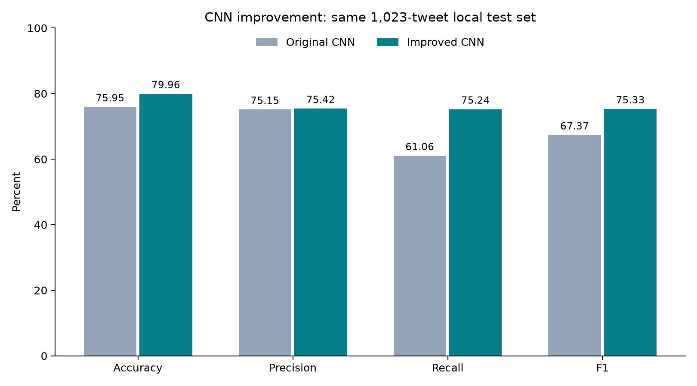

# Improved CNN — September 18, 2026

Final local test accuracy: **79.96%**, disaster-class F1: **75.33%**.

| Metric | Original CNN | Improved CNN | Change (percentage points) |
|---|---:|---:|---:|
| Accuracy | 75.95% | 79.96% | +4.01 |
| Precision | 75.15% | 75.42% | +0.27 |
| Recall | 61.06% | 75.24% | +14.18 |
| F1 | 67.37% | 75.33% | +7.96 |

The new predictor gets **818/1,023 tweets correct**, detects 313/416 disasters, misses 103 disasters, and falsely flags 102/607 non-disasters. The original CNN got 777 correct, detected 254 disasters, missed 162 and falsely flagged 84 non-disasters.



## Selected architecture

GloVe 6B 100-dimensional embeddings → embedding-channel dropout 0.1 → parallel 1D convolutions (widths [2, 3, 4], 64 filters per width) → ReLU → masked max pooling → dropout 0.5 → one output logit.

Embeddings are fine-tuned at learning rate 0.0002. AdamW trains the convolution/classification layers at learning rate 0.001, weight decay 0.01; unweighted binary cross-entropy, batch size 64, gradient norm clipping at 5, maximum 30 epochs and early-stopping patience 6. Checkpoints use validation accuracy, with F1 breaking ties.

Deployment: single CNN with predesignated seed 42. Selected configuration `trial_03`; seeds [42]; validation-selected threshold **0.50**.

Padding-only convolution windows are masked. Short texts retain one zero-padded window. Right-padding is trimmed per batch to save computation without discarding tokens; tests verify predictions are invariant to extra padding and different batch lengths.

## Selection and validation

18 actual training runs: twelve predefined configurations at seed 42, then the top three configurations repeated at seeds 123 and 2026. Search varies frozen/fine-tuned embeddings, convolution widths, filter counts, dropout, pooling and embedding learning rate. The final configuration is chosen by mean seed validation accuracy (then mean F1). For that configuration, designated seed 42 and the three-seed ensemble are compared over a threshold grid 0.30–0.65. Validation accuracy is primary throughout, with F1 breaking ties. `search_plan.json` was saved before training; `selection.json` and checkpoint checksums were saved before the separate evaluation command read test labels.

| Seed for selected configuration | Best epoch | Validation accuracy at 0.5 | Validation F1 at 0.5 |
|---|---:|---:|---:|
| 42 | 4 | 82.00% | 77.99% |
| 123 | 7 | 82.00% | 77.11% |
| 2026 | 4 | 81.51% | 77.47% |

Final deployed predictor at the selected threshold has 82.00% validation accuracy and 77.99% F1.

For transparency, the selected predictor at threshold 0.5 scores 79.96% test accuracy and 75.33% F1. The validation-selected threshold is retained regardless of test outcomes.

## MLP comparison

The improved MLP scores 81.72% accuracy and 76.48% F1 on the same split. The improved CNN differs by -1.76 accuracy points and -1.15 F1 points. This is a descriptive comparison, not a claim of statistically established superiority.

## Reproducibility and limitations

The original preprocessing, 4,770/1,022/1,023 train/validation/test split, training-only vocabulary, baseline checkpoints and results are preserved. No tweet labels were changed. External unsupervised GloVe pretraining is reused from the MLP experiment; only training-vocabulary vectors are loaded. No ID, location or keyword feature is used.

Sources: [Stanford GloVe](https://nlp.stanford.edu/projects/glove/), [verified Gensim download](https://github.com/RaRe-Technologies/gensim-data/releases/download/glove-wiki-gigaword-100/glove-wiki-gigaword-100.gz), [PDDL license](https://opendatacommons.org/licenses/pddl/1-0/). `embedding_provenance.json` contains download and fitted-matrix checksums. Training token coverage is 89.14%.

The local test set has been reused in previous project iterations, so these results are exploratory. The new CNN configuration and threshold were selected only on validation, but repeated validation searches can also overfit. A fresh external labeled test set or nested cross-validation would strengthen generalization claims. These are not Kaggle leaderboard results.

- Accuracy change versus original CNN: paired tweet-bootstrap 95% interval +1.37 to +6.84 percentage points.
- F1 change versus original CNN: paired tweet-bootstrap 95% interval +4.62 to +11.58 percentage points.

Intervals condition on the fitted models and exclude search/seed variation and event-level tweet correlation.

## Commands

From the project root, after baseline preparation and the embedding preparation documented in README:

```bash
./.venv/bin/python src/improve_cnn.py search --run-name cnn_repeat
./.venv/bin/python src/improve_cnn.py evaluate --run-name cnn_repeat
./.venv/bin/python src/report_improved_cnn.py --run-name cnn_repeat
```

Use the saved selected model:

```bash
./.venv/bin/python src/improve_cnn.py predict --text "Flooding has forced residents to evacuate"
```

Checkpoints stay local and are excluded from Git. This folder includes configuration histories, validation predictions, selection evidence, final test predictions, charts, and `kaggle_submission.csv` (3,263 unlabeled competition tweets; not submitted to Kaggle). AI assisted with implementation, training, tests and this report. Team members should review the code and findings before academic submission.
