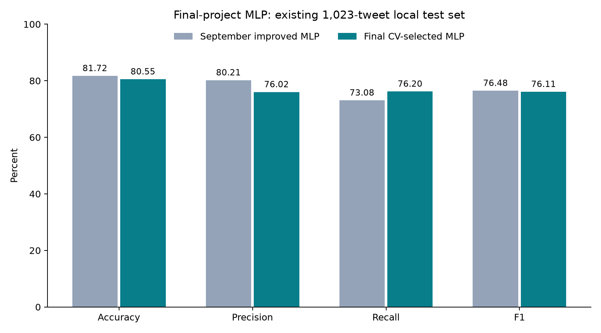

# Final-project MLP experiments — October 16, 2026

The CV-selected predictor obtains **80.55% local test accuracy** and **76.11% disaster-class F1**. The previous improved MLP obtained 81.72% and 76.48%.

## Existing test-set comparison

| Metric | September MLP | CV-selected final MLP | Change (percentage points) |
|---|---:|---:|---:|
| Accuracy | 81.72% | 80.55% | -1.17 |
| Precision | 80.21% | 76.02% | -4.19 |
| Recall | 73.08% | 76.20% | +3.12 |
| F1 | 76.48% | 76.11% | -0.37 |

Correct predictions: 824/1,023 (previous: 836). Detected disasters: 317/416; missed disasters: 99; false alarms: 100/607 non-disasters.



## Cross-validation evidence

The original 4,770-row training split was divided into three stratified outer assessment folds. Each development fold had its own stratified 15% inner early-stopping split. The outer assessment fold was never used for early stopping or fitting vocabulary, IDF, or UNK vectors. The eight candidates were initially run with seed 42; the top two and the current-architecture reference were repeated with seed 123. Selection used mean outer-fold accuracy, with F1 breaking ties. All CV assessment used a fixed threshold of 0.50. The exact row IDs are in folds.json.

| Confirmed configuration | Mean CV accuracy | Descriptive SD | Mean CV F1 | Runs |
|---|---:|---:|---:|---:|
| candidate_04 | 78.87% | 1.80 points | 73.61% | 6 |
| candidate_08 | 78.33% | 1.29 points | 72.33% | 6 |
| candidate_01 | 78.22% | 1.34 points | 71.84% | 6 |

The winning configuration differs from the retrained current-architecture reference by +0.65 CV accuracy points and +1.77 F1 points under the same folds and training protocol. CV models see fewer training examples than the final fitted model, so CV scores should not be directly compared to the previous 81.72% test accuracy. Fold/seed measurements are correlated; the descriptive SD is not an independent confidence interval.

This uses separate inner early-stopping data, but the outer CV scores are still used to select the configuration. They are therefore selection estimates, not a fully independent nested-CV estimate of the entire tuning procedure.

## Final architecture and selection

Configuration: candidate_04. Sources: ['wiki300', 'twitter100']. Concatenated static word embeddings are fine-tuned; the pooling layer combines masked mean and masked max. The classifier is LayerNorm → dropout 0.5 → Dense(128) → ReLU → dropout → one logit. This is an MLP over pooled static embeddings, not a Transformer, CNN or LSTM.

AdamW: embedding learning rate 0.0002, classifier learning rate 0.001, weight decay 0.01; batch size 64; unweighted BCE; gradient clipping at 5; maximum 40 epochs and patience 6. The winning configuration was retrained at five seeds on the original training split, with the original validation split used for early stopping. Validation compared the predesignated seed42 model with the equal-weight five-seed probability ensemble and thresholds 0.35–0.65. The chosen deployment is one MLP, seeds [42], threshold 0.50.

Final validation accuracy/F1: 81.80% / 77.48%; previous validation accuracy/F1: 81.80% / 76.46%.

The prespecified validation gate (both accuracy and F1 must match or exceed the current model) **passed**. The candidate qualifies as a replacement under that validation rule.

Training count: 33 CV fits plus 5 final-training fits. Each fitted model has 4,939,857 parameters; deployment uses 1 model(s). All configurations, fold IDs, checkpoint hashes, epoch histories, and held-out fold probabilities are saved. The final selection was saved before this round’s test evaluation; the test outcome did not change it.

## Data provenance and limitations

The original deduplicated train/validation/test split and all prior model artifacts are preserved. Pretrained vectors come from [Stanford GloVe](https://nlp.stanford.edu/projects/glove/) via the [Gensim data repository](https://github.com/piskvorky/gensim-data). Wiki100/wiki300 use Wikipedia 2014 + Gigaword 6B; Twitter100 uses the Twitter 27B corpus. The vectors use the [PDDL license](https://opendatacommons.org/licenses/pddl/1-0/). Download MD5/SHA-256 and matrix checksums are recorded. Twitter URL/user tokens map to the project’s urltoken/usertoken placeholders. No benchmark labels are used in that mapping. Overlap between the external Twitter pretraining corpus and benchmark tweets has not been audited.

The original validation and test splits have already been reused in previous project iterations. These results are exploratory, not independent confirmation on fresh data. A fresh externally labeled evaluation set would be needed for a stronger final generalization claim. Kaggle’s provided competition test has no labels: the exported submission is not a measured Kaggle leaderboard score.

- Accuracy improvement versus September model: paired tweet-bootstrap 95% interval -3.03 to +0.69 percentage points.
- F1 improvement versus September model: paired tweet-bootstrap 95% interval -2.69 to +1.95 percentage points.

These intervals condition on the fitted models, exclude search/seed uncertainty, and do not account for event correlation. Do not claim statistical superiority when an interval includes zero.

## Reproduce and predict

After preparing baseline data and downloading the three vector files documented in README, use a new run name:

```bash
./.venv/bin/python src/final_mlp.py prepare
./.venv/bin/python src/final_mlp.py search --run-name mlp_final_repeat
./.venv/bin/python src/final_mlp.py confirm --run-name mlp_final_repeat
./.venv/bin/python src/final_mlp.py evaluate --run-name mlp_final_repeat
./.venv/bin/python src/report_final_mlp.py --run-name mlp_final_repeat
```

Use the locally saved final candidate:

```bash
./.venv/bin/python src/final_mlp.py predict --text "Flooding has forced residents to evacuate"
```

The final candidate is stored separately from the September models. Weights and raw vectors are excluded from Git. The Kaggle prediction CSV has not been submitted. Implementation, training, verification and reporting were AI-assisted; team members should review the work and document their actual contributions before academic submission.
