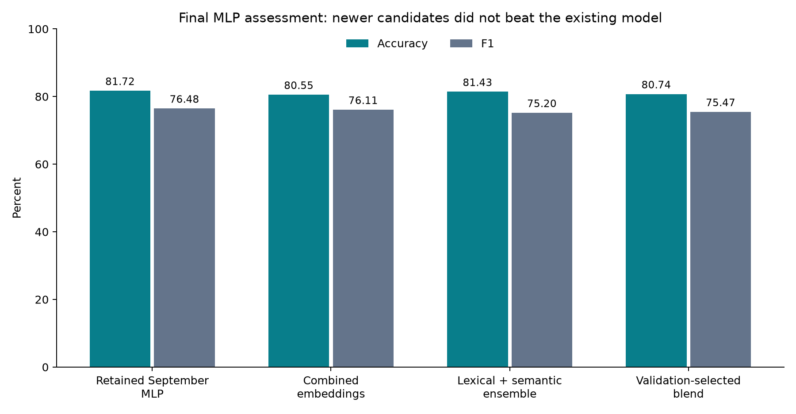

# Final MLP assessment — October 16, 2026

**Recommendation: retain the existing September MLP. Further improvement was not established in this round.** Its observed local test accuracy remains **81.72%**, with **76.48% F1**. The original pre-tuning MLP scored 75.86% accuracy and 65.65% F1; that earlier improvement remains valid as a measured local comparison.

## All observed test outcomes

| Model | Accuracy | Precision | Recall | F1 |
|---|---:|---:|---:|---:|
| Current September MLP | 81.72% | 80.21% | 73.08% | 76.48% |
| Combined-embedding MLP | 80.55% | 76.02% | 76.20% | 76.11% |
| Lexical-semantic MLP ensemble | 81.43% | 82.29% | 69.23% | 75.20% |
| Validation-selected MLP blend | 80.74% | 78.29% | 72.84% | 75.47% |



The new methods occasionally improved cross-validation or validation scores, but none improved both final test accuracy and F1 over the existing model. No original checkpoint or split was overwritten. The CNN was not trained or changed in this October round.

## Work completed

- Downloaded and checksum-verified 300-dimensional Wikipedia/Gigaword GloVe and 100-dimensional Twitter GloVe vectors.
- Tested eight embedding-based MLP configurations: larger vectors, combined sources, IDF-weighted pooling and regularization changes.
- Used three outer assessment folds inside the original training split, with separate inner early-stopping data. Fitted vocabularies, UNK vectors and IDF on inner training only.
- Repeated finalists and the current-architecture reference at a second random seed: 33 CV fits plus 5 full-training confirmation fits.
- Tested four lexical-semantic MLP configurations using word/character TF-IDF with static embeddings: 24 CV fits plus 3 confirmation fits.
- Compared a bounded grid of 15 probability mixtures and 26 thresholds on validation, including the unchanged model as a control. This added no training fits.
- Total: 65 real training fits, plus validation-only mixture selection, saved histories, checkpoint checksums, inference commands, prediction files and tests.

## What can be said in the final project submission

The original MLP was improved from 75.86% to 81.72% local accuracy by the September experiment. Further October experiments with larger embeddings, lexical features and ensembles did not produce a stronger measured test result. This is useful negative evidence: greater model complexity did not guarantee better results in this dataset and protocol. Retaining the simpler existing model is justified by the observed comparisons, while acknowledging that the test set has been reused.

The reference architecture averaged 78.22% CV accuracy under the new smaller training folds; the combined-embedding candidate averaged 78.87%, and the lexical-semantic candidate 79.42%. These were selection scores from correlated fold/seed runs, not independent confirmation. They should not be compared directly with the full-training 81.72% test score.

The existing labeled test partition contains 1,023 tweets and has been evaluated repeatedly. The unsuccessful embedding test was inspected before the lexical follow-up was designed, and the final mixture search was also adaptive. All outcomes are therefore exploratory. Do not describe the October work as a fresh independent benchmark, claim an improvement that did not occur, or claim statistically proven superiority. Fresh independently labeled data would be required to strengthen the final generalization claim.

## Model to use for the submission/demo

- Model: `experiments/mlp_improved_2026_09_18/trial_15_seed42.pt`.
- Selection: `experiments/mlp_improved_2026_09_18/selection.json`.
- Representation: fine-tuned GloVe 6B 100d, masked mean+max pooling, LayerNorm, Dense(128)/ReLU, dropout 0.5 and one output logit.
- Decision threshold: 0.49.
- Observed local test results: 836/1,023 correct, 304/416 disasters detected, 112 missed disasters and 75 false alarms.

```bash
./.venv/bin/python src/improve_mlp.py predict --text "Flooding has forced residents to evacuate"
```

## Detailed experiment records

- `experiments/mlp_final_2026_10_16/report.md`: embedding-only search, CV protocol, source provenance and unsuccessful test outcome.
- `experiments/mlp_fusion_2026_10_16/report.md`: lexical/semantic MLP methodology and all preceding outcomes.
- `experiments/mlp_ensemble_2026_10_16/plan.json`, `selection.json`, `summary.json`: final bounded validation mixture search and test outcome.
- `tests/test_final_mlp.py`, `tests/test_fusion_mlp.py`, `tests/test_ensemble_mlp.py`: fold separation, fitting scope, padding, saved-model predictions and metric verification.
- `verification.log` in this folder: full final test-suite output.

Sources: [Stanford GloVe](https://nlp.stanford.edu/projects/glove/), [Gensim data mirror](https://github.com/piskvorky/gensim-data), [PDDL license](https://opendatacommons.org/licenses/pddl/1-0/). Source and fitted-matrix checksums are saved. All new code, experiments and reporting were AI-assisted and require team review and understanding before submission. No Kaggle submission was sent; exported competition prediction files contain no measured leaderboard score.
