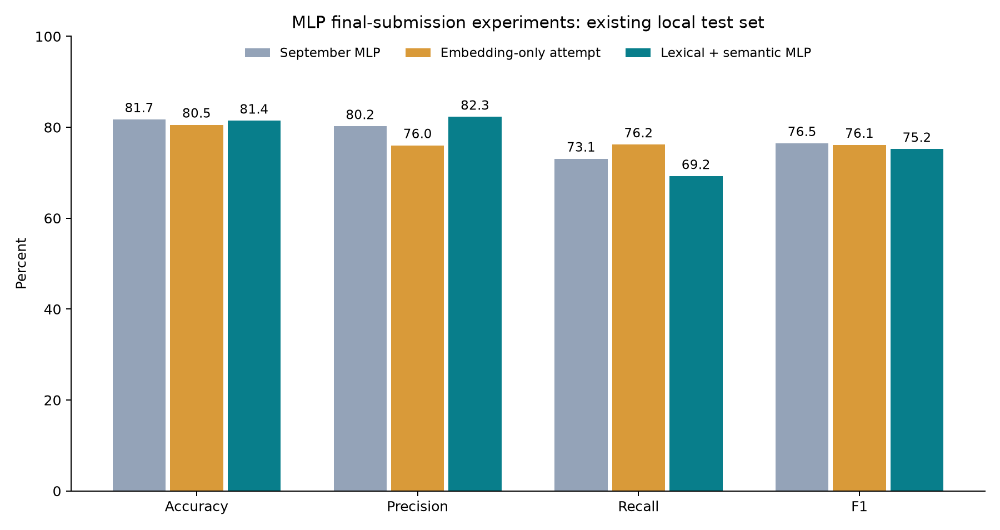

# MLP final-submission experiments — October 16, 2026

The selected lexical-semantic MLP scores **81.43% accuracy** and **75.20% disaster-class F1** on the existing 1,023-tweet local test split.

## Complete comparison — including the unsuccessful attempt

| Model | Accuracy | Precision | Recall | F1 |
|---|---:|---:|---:|---:|
| September MLP | 81.72% | 80.21% | 73.08% | 76.48% |
| Embedding-only attempt | 80.55% | 76.02% | 76.20% | 76.11% |
| Lexical + semantic MLP | 81.43% | 82.29% | 69.23% | 75.20% |

Relative to September: accuracy -0.29 percentage points; F1 -1.28 points. Correct test predictions: 833/1,023 (September: 836). Detected disasters: 288/416; missed disasters: 128; false alarms: 62/607 non-disasters.



The first October attempt combined Wikipedia and Twitter embeddings. It improved the validation F1 but reduced test accuracy to 80.55% and F1 to 76.11%. That result was inspected before the follow-up was designed and is retained here. The follow-up therefore remains adaptive and exploratory; its test result is not a fresh independent confirmation.

## What the selected model does

1. Semantic input: frozen ['wiki300'] word embeddings, masked mean and max pooling, LayerNorm, dropout 0.3, Dense(64) and ReLU.
2. Lexical input: training-fitted word unigram/bigram TF-IDF (up to 8,000 features) plus character 3–5-gram TF-IDF (up to 8,000 features, weight 0.5); feature scale 5, dropout 0.3, Dense(64) and ReLU.
3. Concatenate both hidden representations; dropout 0.5, Dense(64), ReLU, dropout, then one output logit.

This remains a feed-forward MLP classification method with two text representations. It does not contain a CNN, LSTM or Transformer. It changes the input representation and classifier relative to the original embedding-average MLP, so describe it explicitly in the methodology rather than calling it only a learning-rate adjustment.

Selected configuration: fusion_04. Deployment uses an equal-weight three-seed MLP probability ensemble, seeds [42, 123, 2026]; threshold 0.50. Training uses AdamW, learning rate 0.001 for dense layers, embedding learning rate 0.0002 only when unfrozen, weight decay 0.01, batch size 64, unweighted BCE, gradient clipping 5, maximum30 epochs and patience6. Validation accuracy selects checkpoints, with F1 breaking ties.

## Cross-validation and model selection

The original 4,770-row training split is divided into three stratified outer assessment folds. Each development fold has a separate stratified 15% inner early-stopping split. All embedding vocabularies, UNK vectors, TF-IDF vocabularies and IDF statistics are fitted on the inner training data only. Both experiments reuse identical fold IDs and seeds42/123. The fusion search compares four configurations over all six fold/seed combinations (24 fits), at fixed threshold0.50.

| Model family under the same folds | Mean CV accuracy | Descriptive SD | Mean CV F1 |
|---|---:|---:|---:|
| Current-architecture reference | 78.22% | 1.34 points | 71.84% |
| Selected fusion configuration | 79.42% | 0.41 points | 73.31% |

CV difference: +1.21 accuracy points and +1.47 F1 points. The reference allowed 40 epochs, while the fusion candidates allowed30, both with patience6. Scores are used for selection; this is not an unbiased nested-CV estimate of the whole tuning process. Fold/seed results are correlated, so SD is descriptive rather than a confidence interval. CV fitting sets are smaller than the final fitting set, so do not compare CV accuracy directly with the September test accuracy.

The winning configuration was trained on the full original training split at three seeds, using the original validation split for early stopping. Validation compared designated seed42 versus the three-seed ensemble and thresholds0.35–0.65. The final model and threshold were locked before this follow-up’s test evaluation. The test result did not change that choice.

Final validation accuracy/F1: 80.53% / 73.50%. Previous validation accuracy/F1: 81.80% / 76.46%. Validation gate requiring both metrics to match or exceed the current model: **not passed**.

Total October fitting runs: 33 embedding-only CV fits +5 confirmation fits, followed by24 fusion CV fits +3 confirmation fits =65 fits. Original checkpoints and data remain intact. Each attempt has its own saved plan, fold IDs, histories, checkpoint hashes and predictions.

## Evidence limits for the final submission

The original validation and test sets have been reused across several project iterations. These results support an exploratory comparison, not guaranteed performance on future tweets. A new independently labeled test set or nested cross-validation of the entire selection process would strengthen the final claim. All stages, including the failed attempt, should be reported.

- Accuracy improvement versus September: paired tweet-bootstrap95% interval -2.54 to +1.76 percentage points.
- F1 improvement versus September: paired tweet-bootstrap95% interval -4.14 to +1.33 percentage points.

These intervals condition on the fitted models and do not capture selection/seed uncertainty or correlations between tweets about the same event. If an interval includes zero, do not describe that gain as statistically established.

Data: the original Kaggle disaster-tweet training file, with the same existing deduplication and conflicting-label exclusions. No labels were manually changed in October. Pretrained vectors: [Stanford GloVe](https://nlp.stanford.edu/projects/glove/) via the [Gensim mirror](https://github.com/piskvorky/gensim-data), [PDDL license](https://opendatacommons.org/licenses/pddl/1-0/). Source and matrix checksums are preserved in the embedding provenance files. Twitter-corpus overlap with benchmark tweets was not audited; the final fusion candidate’s source choice is listed above.

## Run the saved model

```bash
./.venv/bin/python src/fusion_mlp.py predict --text "Flooding has forced residents to evacuate"
```

To reproduce with a new output folder after preparing the same split and wiki100/wiki300 embeddings:

```bash
./.venv/bin/python src/fusion_mlp.py search --run-name mlp_fusion_repeat
./.venv/bin/python src/fusion_mlp.py confirm --run-name mlp_fusion_repeat
./.venv/bin/python src/fusion_mlp.py evaluate --run-name mlp_fusion_repeat
./.venv/bin/python src/report_fusion_mlp.py --run-name mlp_fusion_repeat
```

The saved fold definition at experiments/mlp_final_2026_10_16/folds.json is required. Raw vectors and checkpoints stay local and are excluded from Git. Load only trusted local joblib vectorizers. The unsubmitted kaggle_submission.csv contains predictions for3,263 unlabeled competition tweets; it is not a leaderboard score. AI assisted with code, experiments, tests and reporting; team members should verify and understand the final methodology before submission.
