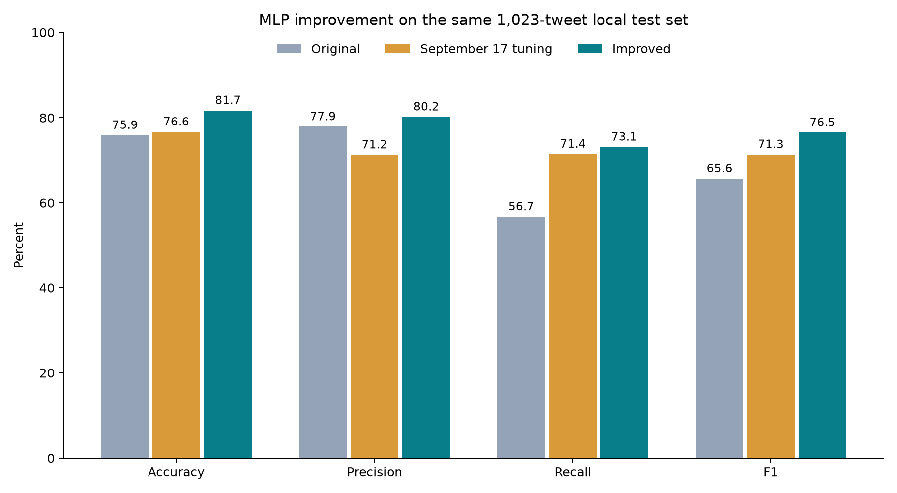

# Improved MLP — September 18, 2026

Selected model: **81.72% accuracy and 76.48% disaster-class F1** on the existing local labeled test set.

## Measured comparison

| Metric | Original MLP | September 17 tuning | Improved MLP | Change vs original (points) | Change vs September 17 (points) |
|---|---:|---:|---:|---:|---:|
| Accuracy | 75.86% | 76.64% | 81.72% | +5.87 | +5.08 |
| Precision | 77.89% | 71.22% | 80.21% | +2.32 | +8.99 |
| Recall | 56.73% | 71.39% | 73.08% | +16.35 | +1.68 |
| F1 | 65.65% | 71.31% | 76.48% | +10.83 | +5.17 |

All rows use the same 1,023 held-out labeled tweets, including 416 disaster tweets and 607 non-disaster tweets. These are local results, not Kaggle leaderboard scores.

The improved model gets **836/1,023 correct**, detects **304/416 disasters**, misses 112, and falsely flags 75 non-disasters. Original counts: 776 correct, 236 detected disasters, 180 misses, 67 false alarms. September 17 counts: 784 correct, 297 detected disasters, 119 misses, 120 false alarms.



## What changed

GloVe 6B pretrained 100-dimensional word vectors → masked mean+max pooling → LayerNorm → dropout → Dense(128) → ReLU → dropout → one output logit. Embeddings are fine-tuned at learning rate 0.0002.

Selected configuration: `trial_15`. AdamW learning rate 0.001, weight decay 0.01, dropout 0.5, batch size 64; unweighted binary cross-entropy. Maximum 40 epochs with patience 7, checkpoint chosen by validation F1 then accuracy. Gradient norm clipped to 5. This remains an MLP classification approach; no CNN, recurrent network or Transformer was added.

Deployment uses one MLP, using the predesignated seed 42. Seeds: [42]. Decision threshold: **0.49**, selected using validation data.

## Search protocol

30 real training runs: 16 GloVe MLP configurations (frozen/fine-tuned embeddings, mean/mean+max pooling, two hidden/dropout settings, weighted/unweighted loss) and eight TF-IDF MLP configurations (word/word+character features, two hidden sizes, two weight decays), followed by two additional seeds for each of the top three configurations.

The initial search screened configurations by validation F1, then compared the top three across seeds 42, 123 and 2026. After seeing nearly tied F1 but different accuracy, an additional validation-only selection stage prioritized the user’s accuracy objective. Its policy was saved in accuracy_refinement_plan.json before computing threshold comparisons. It compares each finalist’s predesignated seed-42 model and three-seed ensemble over thresholds 0.30–0.65, selecting validation accuracy first and F1 as a tie-breaker. This adaptive refinement is explicitly separate from the original F1-first plan, whose selection is preserved in selection_f1_screening.json. Final configuration, checkpoint checksums, seeds and threshold were saved before a separate evaluation command read test labels. No changes were selected using this round’s test outcomes.

| Selected configuration seed | Best epoch | Validation accuracy at 0.5 | Validation F1 at 0.5 |
|---|---:|---:|---:|
| 42 | 31 | 81.70% | 76.18% |
| 123 | 30 | 81.60% | 76.32% |
| 2026 | 27 | 81.41% | 75.95% |

Final deployed model’s validation accuracy/F1 at the selected threshold: 81.80% / 76.46%.

For transparency, the same final predictor at the standard 0.50 threshold scores 81.62% test accuracy and 76.20% F1. Deployment retains the validation-selected threshold.

## Data and pretrained-vector provenance

The dataset, deduplication, excluded conflicting normalized texts, and 4,770/1,022/1,023 train/validation/test split remain unchanged. TF-IDF vocabulary and IDF are fit exclusively on training data. GloVe was pretrained externally without these supervised target labels; the embedding table retains the original training-only project vocabulary. Keyword, location and ID are not input features.

Downloaded verified GloVe 6B 100d vectors from the [Gensim data mirror](https://github.com/RaRe-Technologies/gensim-data/releases/download/glove-wiki-gigaword-100/glove-wiki-gigaword-100.gz); original [Stanford GloVe project](https://nlp.stanford.edu/projects/glove/) and [paper](https://nlp.stanford.edu/pubs/glove.pdf). Vectors use the [PDDL license](https://opendatacommons.org/licenses/pddl/1-0/). Matched 10,227/12,087 training vocabulary words; training token coverage 89.14%. Download MD5 and SHA-256, fitted matrix checksum and vocabulary checksum are recorded in `embedding_provenance.json`.

## Limits and uncertainty

The original test set has now been reused across project iterations. Although this search did not use test labels for model selection, these are exploratory comparisons, not independent confirmation on a fresh benchmark. More searches can overfit a validation set. A new external labeled test set or nested cross-validation is needed for a stronger generalization claim.

- Accuracy change vs original: paired tweet-bootstrap 95% interval **+3.32 to +8.41 percentage points**.
- F1 change vs original: paired tweet-bootstrap 95% interval **+7.31 to +14.48 percentage points**.

Bootstrap intervals condition on the fitted models and exclude training/search variation and correlations among tweets about the same event. Validation error inspection also revealed ambiguous/context-dependent examples and apparently questionable labels. No labels were manually corrected or examples removed in this tuning round. The result is the best under the recorded search protocol, not a claim of the maximum achievable accuracy.

## Reproduce and use

From the project root:

```bash
./.venv/bin/python src/improve_mlp.py predict --text "Flooding has forced residents to evacuate"
```

To repeat the search, first follow `README.md` to prepare baseline data and embeddings, then choose a new run name:

```bash
./.venv/bin/python src/improve_mlp.py search --run-name mlp_improved_repeat
./.venv/bin/python src/select_mlp_accuracy.py --run-name mlp_improved_repeat
./.venv/bin/python src/improve_mlp.py evaluate --run-name mlp_improved_repeat
```

Checkpoints are local and excluded from Git. TF-IDF serialization, if used, must only be loaded from trusted local files. `kaggle_submission.csv` contains predictions for the 3,263 unlabeled competition test tweets; it has not been submitted to Kaggle.

Original checkpoints, the September 17 checkpoint, split files and baseline results are preserved, with SHA-256 checks in `input_hashes.json`. Training configurations, epoch histories, selection evidence and test probabilities are saved alongside this report. AI-assisted code, training and reporting should be reviewed and understood by the team before submission.
