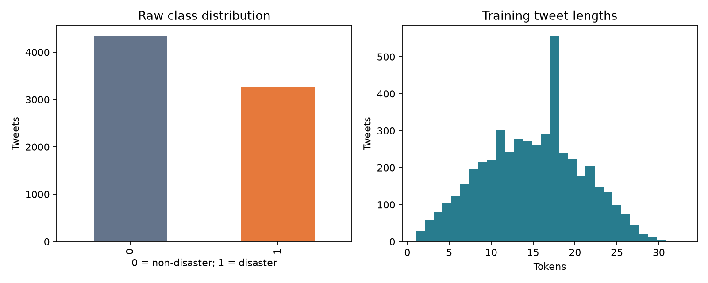
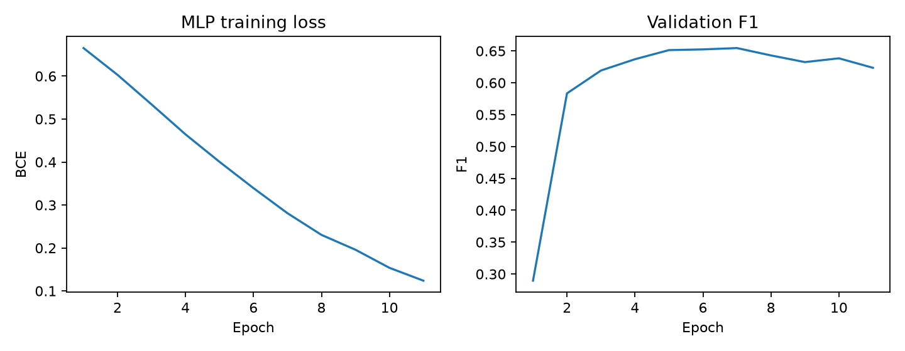
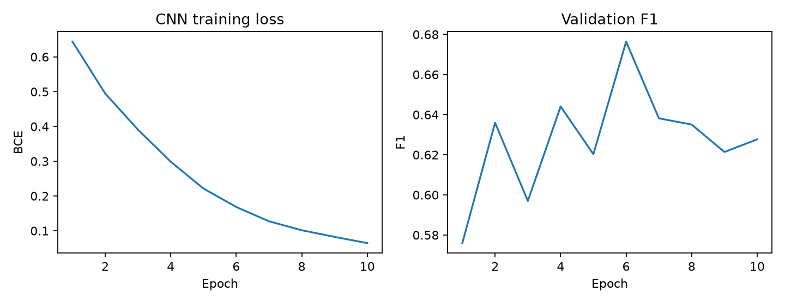
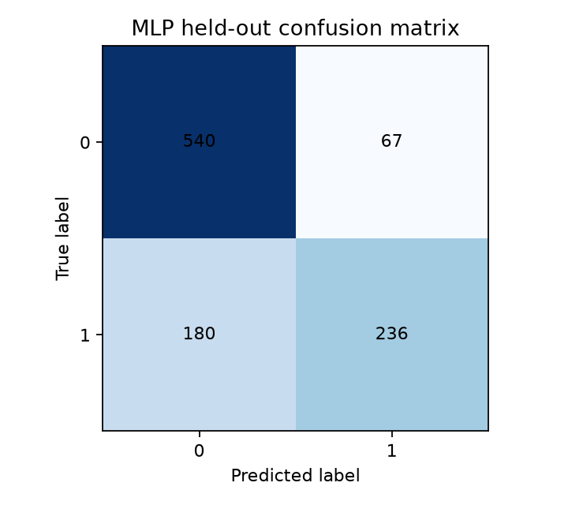
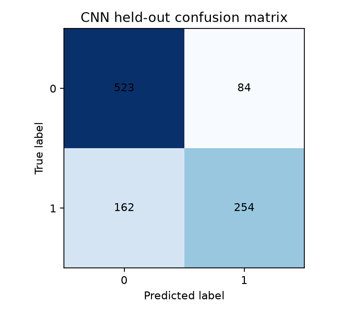

# Comparative analysis of deep learning architectures for disaster tweet classification

## Interim report for ICT 4442

Interim deadline: 25 September 2026. Experiment date: 16 September 2026.

Team: Shreya Roshan (230911046), Tanisha Mathur (230953110), Adithya Kini (230911008), Arnab Sinha (230911356). Team number: to be completed by the team.

## Progress and objectives

The project classifies whether a tweet describes a real disaster using tweet text alone. Two of the four proposed architectures have been implemented and evaluated: a feed-forward MLP baseline and a one-dimensional CNN. Both learn embeddings from scratch and use the same data preparation and evaluation protocol. On the held-out partition, CNN F1 is 0.6737, compared with 0.6565 for MLP. These are preliminary results from one seed; LSTM and encoder-only Transformer experiments remain for the final phase.

The objectives are to compare distinct neural architecture families under a common protocol, measure predictive performance alongside parameter count and training time, and investigate errors involving ambiguous or figurative disaster language.

## Dataset acquisition and exploratory analysis

The dataset is Kaggle Natural Language Processing with Disaster Tweets. The raw training file contains 7,613 labeled tweets: 4,342 non-disaster and 3,271 disaster tweets. The competition test file contains 3,263 unlabeled tweets, giving 10,876 total rows across the two files. This corrects the rounded 10,000 figure in the synopsis.

Files were acquired from a pinned public GitHub mirror of the competition CSVs after a direct Kaggle download was unavailable. This is not an authenticated Kaggle download. The raw files passed row-count, class-count, required-column, unique-ID and nonempty-text checks. SHA-256 values and the exact pinned URLs are recorded in data/raw/provenance.json. These checks validate expected structure and contents but do not establish byte identity against an independently downloaded official archive.

Only text is a model input. ID is retained for traceability; keyword and location are excluded. Missing keyword and location counts are 61 and 2533, respectively. Since those fields are unused, they are not imputed.

## Preprocessing and partitioning

HTML entities are decoded and text lowercased. URLs become urltoken, user mentions become usertoken, and hashtag words are retained without the hash. The tokenizer retains English letters, digits and word-internal apostrophes. Negation and stop words remain. Stemming, lemmatization and pretrained embeddings are not used. Removing punctuation and non-ASCII characters may lose useful cues; this is a documented baseline limitation.

Normalized inputs with conflicting labels are excluded rather than silently relabeled. This removes 282 conflicting or empty rows, involving 79 conflicting normalized texts. A further 516 same-label duplicate rows are collapsed. The resulting 6815 unique examples are stratified approximately 70/15/15 using seed 42. Duplicate detection precedes splitting as a fixed data-curation policy. It uses labels only to identify contradictions; excluded examples are outside the reported evaluation population. This exclusion changes the benchmark population and may remove difficult examples.

| Partition | Rows | Disaster | Non-disaster |
|---|---|---|---|
| Train | 4770 | 1942 | 2828 |
| Validation | 1022 | 416 | 606 |
| Test | 1023 | 416 | 607 |

No identical normalized text or ID crosses partitions. Near-duplicates and related tweets about the same event can still cross partitions; this is not an event-held-out benchmark. Vocabulary fitting uses training text only and produces 12089 entries including PAD and UNK. Inputs are right-padded or truncated to 64 tokens. The maximum observed training length is 33 tokens.

## Method one MLP baseline

Each token maps to a trainable 128-dimensional embedding. Non-padding embeddings are averaged, producing a single tweet vector. A 64-unit dense layer with ReLU, dropout 0.4 and a final scalar linear layer produce a logit. Sigmoid converts the logit to a disaster probability during inference. This is an embedding-averaging feed-forward baseline inspired by deep averaging networks [7], not a reproduction of the original paper. It discards word order, so reversing the same tokens leaves its representation unchanged.

## Method two one-dimensional CNN

Each token maps to a trainable 128-dimensional embedding. Three parallel one-dimensional convolution branches use widths 3, 4 and 5, with 64 filters per branch. ReLU and global max pooling produce 64 features per branch. Concatenating the branches gives 192 features, followed by dropout 0.4 and one output logit. Padding-only convolution windows are masked before pooling; inputs shorter than a kernel use one padded window. This model can learn local phrase patterns, drawing architectural motivation from [3,6]. It uses randomly initialized embeddings and therefore differs from pretrained-embedding CNNs in the literature.

## Common experimental setup

Both models use Adam with learning rate 0.001, binary cross-entropy with logits, batch size 64 and seed 42. The maximum budget is 20 epochs; training stops after four epochs without a strict validation F1 improvement. The checkpoint with the best positive-class validation F1 is retained. The classification threshold is fixed at 0.5, and no test labels are used for checkpoint selection or threshold tuning. There is no hyperparameter search in this interim run.

Runs use CPU with four PyTorch threads and deterministic algorithms on arm64, Python 3.13.1. Exact dependencies are in requirements.txt. Training time covers optimization and per-epoch validation, excluding dataset preparation, plotting, checkpoint export and final test evaluation. Parameter counts include the embedding tables and padding row. Different model capacities and inductive biases remain despite the common settings.

Accuracy is the fraction of correct predictions. Precision is TP/(TP+FP), recall is TP/(TP+FN), and positive-class F1 is 2PR/(P+R). The disaster class, label 1, is the positive class. Undefined precision/recall/F1 are assigned zero by the evaluator.

## Preliminary held-out results

| Model | Accuracy | Precision | Recall | F1 | Parameters | Train seconds | Best epoch |
|---|---|---|---|---|---|---|---|
| MLP | 0.7586 | 0.7789 | 0.5673 | 0.6565 | 1555713 | 1.61 | 7 |
| CNN | 0.7595 | 0.7515 | 0.6106 | 0.6737 | 1646081 | 49.36 | 6 |

The majority-class predictor would achieve 0.5934 accuracy and zero positive-class F1 on this held-out partition. Both neural models exceed that reference. CNN gains 0.0173 absolute F1 over MLP in this single run, with higher recall but lower precision. This pattern is consistent with a possible benefit from phrase features, but it does not establish causality or statistical significance. CNN also costs more training time. Both models miss many actual disaster examples; they are research baselines rather than reliable emergency classifiers.

Learning curves show decreasing training loss without consistent validation improvement, indicating overfitting. Early stopping limits further fitting. Future changes should be chosen on validation data, retaining the held-out test for final evaluation. Repeatedly consulting this interim test result when tuning would weaken its value as an unbiased final evaluation.

## Error analysis and reproducibility evidence

Full predictions and misclassified examples are exported separately for each model. The files include original tweet IDs and text, labels, probability estimates and predictions. Blank category/notes columns support team review; categories have not been automatically assigned or presented as human annotation. Review false positives and false negatives for figurative language, ambiguity, slang, missing context and annotation inconsistency.

Saved checkpoints include the model configuration and training vocabulary, allowing standalone predictions. Automated checks cover split disjointness, training-only vocabulary, preservation of negation/hashtag words, empty and unknown inputs, padding invariance, checkpoint reload equivalence and recalculation of reported metrics from exported predictions. Check reports/test_results.log for the actual test outcome.

## Literature review

These nine papers connect the simple baselines to crisis classification and contextual language models. Published numbers use different datasets, splits, preprocessing, and sometimes metric averaging. They are context, not directly comparable scores for this implementation. Qualitative findings are given where a single comparable numeric result is inappropriate.

| Paper | Method | Dataset or task | Key result | Relevance and limitation |
|---|---|---|---|---|
| [1] Balakrishnan et al. (2022), A Comprehensive Analysis of Transformer-Deep Neural Network Models in Twitter Disaster Detection | Transformer representations combined with neural classifiers | 7,613 Kaggle disaster tweets | Reports F-scores of 0.80–0.84 for simpler transformer variants, particularly with BiLSTM | Direct task match; motivates later contextual models. Pretraining and its 80/20 protocol differ from our from-scratch experiment. |
| [2] Dharrao et al. (2024), An efficient method for disaster tweets classification using gradient-based optimized convolutional neural networks with BERT embeddings | BERT embeddings, CNN, optimizer comparison | Disaster tweet classification dataset | BERT-CNN-RMSProp: reported macro F1 0.80 and validation accuracy 0.83 | Motivates CNN and optimization studies. Macro F1 is not our positive-class F1; embeddings and splits differ. |
| [3] Nguyen et al. (2017), Robust Classification of Crisis-Related Data on Social Networks Using Convolutional Neural Networks | CNN with transfer from other crisis events | Crisis-related social-network messages; event-based useful-tweet classification | Shows that out-of-event labeled data can support classification when a new event has no labels | Motivates local phrase features and future event-held-out tests. Useful-tweet labels differ from disaster/non-disaster labels. |
| [4] Kabir and Madria (2019), A Deep Learning Approach for Tweet Classification and Rescue Scheduling for Effective Disaster Management | Attention-based BiLSTM plus CNN, pretrained embeddings and auxiliary features | Hurricanes Harvey/Irma; four CrisisNLP and fifteen CrisisLex disaster datasets | Reports improvements over comparison classifiers; Nepal earthquake AUC 87.5 for CNN with attention and auxiliary features versus 84.8 for CNN comparison | Motivates recurrent/attention extensions. Uses metadata and rescue categories; it is not a Transformer-only study. |
| [5] Alam et al. (2021), HumAID Human-Annotated Disaster Incidents Data from Twitter with Deep Learning Benchmarks | Classical, fastText and Transformer multiclass benchmarks | Approximately 77,000 labeled tweets across 19 disaster events | Releases a larger human-annotated benchmark and multiclass baselines | Useful future external evaluation; humanitarian multiclass categories do not map directly to the present binary task. |
| [6] Kim (2014), Convolutional Neural Networks for Sentence Classification | One-layer CNN over pretrained word vectors, multiple filter widths, max pooling | Seven sentence-classification tasks including sentiment and questions | CNN variants improve the then state of the art on four of seven tasks | Architectural basis for our 3/4/5-token CNN; ours learns embeddings from scratch, so it is not a reproduction. |
| [7] Iyyer et al. (2015), Deep Unordered Composition Rivals Syntactic Methods for Text Classification | Deep averaging network over embeddings | Sentiment analysis and factoid question answering | An unordered neural model competes with syntactic models at lower training cost | Motivates masked mean embeddings plus MLP. Our one-hidden-layer baseline is a simplified variant without their word-dropout procedure. |
| [8] Devlin et al. (2019), BERT Pre-training of Deep Bidirectional Transformers for Language Understanding | Bidirectional Transformer pretraining and task fine-tuning | GLUE, MultiNLI, SQuAD and other NLP benchmarks | Reports GLUE 80.5 and MultiNLI accuracy 86.7% | Motivates contextual representation for the final phase; these are not disaster-tweet scores. Pretraining must be disclosed in any comparison. |
| [9] Zhang and Wallace (2015; revised 2016), A Sensitivity Analysis of and Practitioners' Guide to Convolutional Neural Networks for Sentence Classification | Controlled one-layer CNN hyperparameter experiments | Sentence classification benchmarks | Establishes practical guidance on architecture and hyperparameter sensitivity | Supports validation-only tuning of filters and dropout. Does not establish the best settings for this dataset. |

## Comparative synthesis

The averaging approach [7] offers a computationally simple baseline but loses word order. CNNs [3,6] capture short phrases, which may help distinguish disaster descriptions from isolated disaster-related words. Their benefits depend on configuration [9], training data, and word representations. Contextual models [1,2,8] address meanings that depend on surrounding words, but pretrained representations introduce an additional source of information beyond architecture alone. The hybrid rescue pipeline [4] and HumAID [5] broaden the task to operational categories; those results cannot be treated as binary disaster-detection scores.

This interim experiment therefore compares two from-scratch text-only models using the same vocabulary, embedding dimension, data partitions, threshold, training budget and metrics. Model capacity differs and is reported through parameter counts. Later LSTM and encoder-only Transformer experiments should reuse these saved partitions. A pretrained Transformer should be identified as an additional transfer-learning condition rather than attributed solely to architecture.

## Sources

1. Balakrishnan et al., Mathematics 10(24), 4664, 2022. https://www.mdpi.com/2227-7390/10/24/4664
2. Dharrao et al., MethodsX 13, 102843, 2024. https://doi.org/10.1016/j.mex.2024.102843 ; full text: https://pmc.ncbi.nlm.nih.gov/articles/PMC11296064/
3. Nguyen et al., ICWSM 11(1), 632–635, 2017. https://ojs.aaai.org/index.php/ICWSM/article/view/14950
4. Kabir and Madria, ACM SIGSPATIAL, 269–278, 2019. https://doi.org/10.1145/3347146.3359097 ; author preprint: https://arxiv.org/abs/1908.01456
5. Alam et al., ICWSM 15(1), 933–942, 2021. https://ojs.aaai.org/index.php/ICWSM/article/view/18116
6. Kim, EMNLP, 1746–1751, 2014. https://aclanthology.org/D14-1181/
7. Iyyer et al., ACL-IJCNLP, 1681–1691, 2015. https://aclanthology.org/P15-1162/
8. Devlin et al., NAACL-HLT, 4171–4186, 2019. https://aclanthology.org/N19-1423/
9. Zhang and Wallace, arXiv:1510.03820, 2015, revised 2016. https://arxiv.org/abs/1510.03820

Sources checked on 16 September 2026. The team should read the linked papers and verify the summaries before signing the report.

## Remaining work and risk plan

| Date | Work | Evidence or risk response |
|---|---|---|
| 16–19 September | Team reviews preprocessing, MLP and CNN; confirms ownership | Run walkthrough and tests; record actual individual changes and commits |
| 20–22 September | Review papers and inspect false positives/negatives | Verify literature claims and annotate real error examples |
| 23–24 September | Integrate official Part B template and contribution statement | Add team number, real contributions, signatures and institutional checks |
| 25 September | Interim submission | Submit report through course MS Form before 11:59 PM |
| 26 September–10 October | Implement LSTM and encoder-only Transformer | Reuse saved splits and vocabulary; start with modest model sizes |
| 11–15 October | Validation-only tuning and repeated seeds | Address overfitting with regularization; record all configurations and seed variability |
| 16–24 October | Final comparison, error analysis and report | Document limitations and genuine individual contributions |
| 26–29 October | Presentation and viva | Each member explains their own model and experimental decisions |
| 31 October | Final report and code | Complete all four models, references and repository submission |

Compute risk is limited for these two small baselines, but Transformer training may need a smaller model or available accelerator. Pretrained variants must be reported separately to distinguish transfer learning from architecture effects. Dataset ambiguity and event overlap remain risks even after duplicate cleanup. Save the present artifacts before subsequent experiments so changes remain auditable.

## Individual contribution statement

This initial implementation was generated and run with OpenAI Codex assistance on 16 September 2026. It must not be represented as independently completed work by any named student. Members should record their actual review, modifications, experiments, writing and commits below. The synopsis assigns anonymous Member 1–4 roles; name-to-model ownership has not been confirmed.

| Member | Registration number | Actual completed tasks | Commit hashes or evidence | Date | Signature |
|---|---|---|---|---|---|
| Shreya Roshan | 230911046 | To be completed by member | | | |
| Tanisha Mathur | 230953110 | To be completed by member | | | |
| Adithya Kini | 230911008 | To be completed by member | | | |
| Arnab Sinha | 230911356 | To be completed by member | | | |

## Proposed roles from the synopsis

| Role | Scope | Named owner |
|---|---|---|
| Member 1 | Data preparation, MLP, EDA | Team to confirm |
| Member 2 | CNN and tuning | Team to confirm |
| Member 3 | LSTM and training analysis | Team to confirm |
| Member 4 | Transformer, comparison and error analysis | Team to confirm |

Create a shared repository using each member's own account for their actual work. Commit real changes incrementally. Do not backdate commits or assign this generated baseline to members as if they authored it independently. No GitHub repository has been created or published by this session.

## Disclosure of assistance

Tool: OpenAI Codex. Date: 16 September 2026.

Codex assisted with reading the supplied synopsis/guidelines, acquiring the public mirror of the Kaggle dataset, writing `src/project.py`, model training, `tests/test_project.py`, report-generation code, the walkthrough notebook, literature summarization, and project documentation. Source papers and dataset attribution are provided in the report. Reported project metrics were produced by actual local model runs, not estimated or copied from publications.

Team members must review the code, verify literature statements against the papers, understand the model behavior, and record their actual subsequent contributions. This disclosure does not establish compliance with institutional AI-content thresholds. The required Turnitin/plagiarism and AI-content checks must be obtained through the institution; no percentage or certificate has been generated here.

## Submission preparation

The official Part B template was not included with the supplied synopsis and guidelines. This report provides interim content, but the team must transfer it into that template, verify its accuracy, complete its genuine contribution evidence and signatures, and perform the institutional checks before submission. The course submission has not been made.
