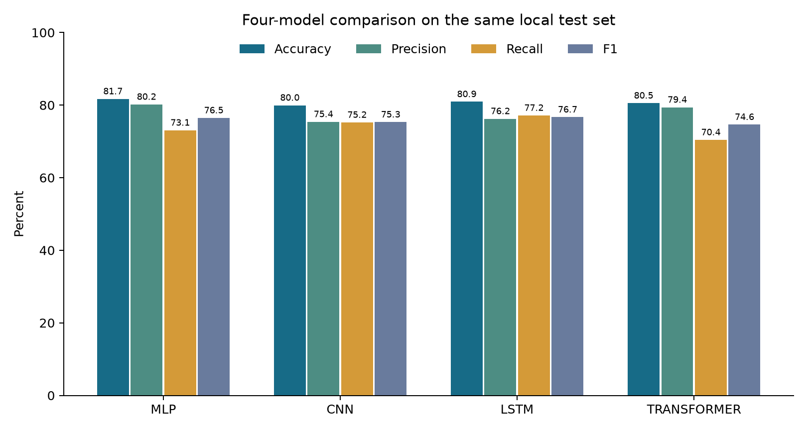
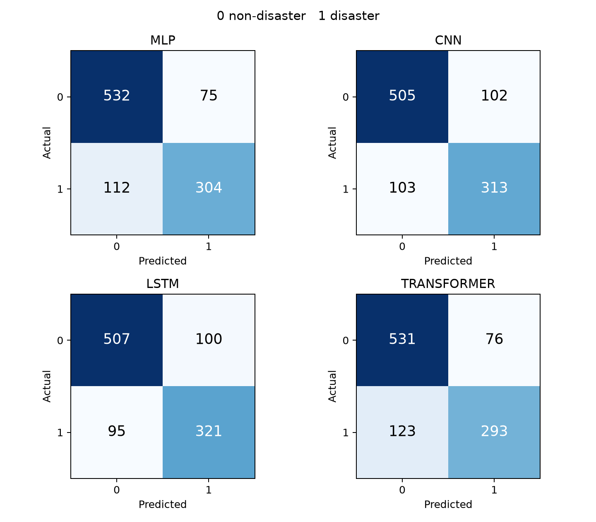

# Comparative Analysis of Deep Learning Architectures for Disaster Tweet Classification

## Abstract

This project compares a multilayer perceptron, a one-dimensional convolutional neural network, a bidirectional long short-term memory network, and an encoder-only Transformer for binary disaster-tweet classification. All models use the same text-only cleaning pipeline, training-fitted vocabulary, GloVe word-vector source, and saved train-validation-test partition. After excluding conflicting normalized labels and repeated normalized tweets, 6,815 unique labeled examples remain. Models are selected on validation data and evaluated on the same 1,023-row local test set. MLP achieves the highest observed accuracy at 81.72%, while LSTM has the highest observed F1 at 76.70% and recall at 77.16%. The F1 difference between these models is small. The results show a tradeoff between conservative predictions and disaster recall rather than a universal benefit from architectural complexity. Reused test data, label ambiguity, different historical search budgets, and the absence of independent external evaluation limit generalization claims.

Keywords: disaster tweets; text classification; MLP; CNN; bidirectional LSTM; encoder-only Transformer; GloVe.

## 1 Introduction

Social-media posts can contain useful descriptions of emergencies, but short messages also contain jokes, figurative expressions, references to past events and missing context. A word such as fire can describe a hazard or enthusiastic slang. This project classifies the supplied tweet text according to the dataset label; it does not verify whether an event actually happened or whether a user is trustworthy.

The research question is how feed-forward, convolutional, recurrent and self-attention architectures differ under common data preparation and evaluation. The study emphasizes reproducible comparison, saved experimental evidence and qualitative error analysis rather than a production emergency-response system.

## 2 Objectives

Implement four distinct architecture families using a shared preprocessing and evaluation pipeline.

Compare accuracy, precision, recall, positive-class F1, ROC AUC, parameter count and measured CPU training cost.

Analyze false positives and false negatives and identify limitations involving ambiguity, context and data quality.

## 3 Literature Review

Disaster-classification studies [1–5] investigate contextual models, CNNs, cross-event transfer and operational categories. Their datasets, labels, auxiliary features and pretraining differ, so published numbers provide context rather than directly comparable target scores.

The four families are grounded in unordered composition [7], sentence CNNs [6,9], recurrent memory [10] and self-attention [11]. All use common GloVe vectors [12] and AdamW [13]. Unlike BERT [8], the encoder here has no contextual language-model pretraining. This distinction separates representation resources from architecture.

### 3 1 Comparative literature summary

| Study | Method or task | Relevance to this comparison |
|---|---|---|
| [1] Balakrishnan 2022 | Transformer representations with neural classifiers | Contextual classifiers; different split and pretraining. |
| [2] Dharrao 2024 | BERT representations, CNN and optimizer comparison | BERT and CNN; a different evaluation protocol. |
| [3] Nguyen 2017 | CNN and cross-event training | Crisis transfer; motivates event-held-out testing. |
| [4] Kabir 2019 | Attention BiLSTM, CNN and auxiliary features | Rescue scheduling extends beyond binary text labels. |
| [5] HumAID 2021 | Dataset and multiclass baselines | Larger humanitarian multiclass benchmark. |
| [6] Kim 2014 | Parallel convolution filters over word vectors | Motivates local phrase filters and pooling. |
| [7] Iyyer 2015 | Deep averaging networks | Motivates a simple unordered neural baseline. |
| [8] BERT 2019 | Bidirectional Transformer pretraining | Contextual pretraining is a separate condition. |
| [9] Zhang 2015 | Controlled CNN hyperparameter analysis | Supports validation-based hyperparameter search. |
| [10] LSTM 1997 | Gated recurrent memory | Memory gates motivate the recurrent model. |
| [11] Transformer 2017 | Self-attention and positional encoding | Self-attention and positions motivate the encoder. |
| [12] GloVe 2014 | Global co-occurrence word representations | Supplies the shared static word vectors. |
| [13] AdamW 2019 | AdamW optimizer | Supplies the common optimization mechanism. |

These studies motivate architectural diversity but do not identify a universal winner. The common data protocol and selected hyperparameters are detailed below.

## 4 Dataset and Shared Preprocessing

The primary dataset is Kaggle Natural Language Processing with Disaster Tweets [14]. Its labeled training CSV has 7,613 rows; the separate competition test CSV has 3,263 rows without labels. Files were acquired through a pinned public mirror, and source URLs plus SHA-256 checksums are recorded. Only text is an input feature. ID identifies rows, target supplies the label, and keyword/location are excluded.

| Processing stage | Rows or count |
|---|---|
| Original labeled rows | 7,613 |
| Conflicting-label or empty rows excluded | 282 |
| Conflicting normalized texts | 79 |
| Repeated same-label normalized rows removed | 516 |
| Retained unique labeled rows | 6,815 |
| Training vocabulary including PAD and UNK | 12,089 |

The single preprocessing module decodes HTML, lowercases text, replaces URLs with urltoken and mentions with usertoken, and extracts alphanumeric words with internal apostrophes. Hashtag words and negation are retained. No stopword deletion or stemming is applied. For each normalized text with consistent labels, one row is retained; normalized texts with contradictory labels are excluded before splitting. This global label-consistency filtering changes the benchmark population and must be disclosed.

| Partition | Rows | Disaster | Non disaster |
|---|---|---|---|
| Train | 4770 | 1942 | 2828 |
| Validation | 1022 | 416 | 606 |
| Test | 1023 | 416 | 607 |

A stratified 70/15/15 split with seed 42 is saved and reused. The vocabulary is fitted on training text only, capped at 20,000 entries, with PAD=0 and UNK=1. Encodings contain up to 64 tokens with right padding; an empty cleaned input becomes UNK. Split IDs, file checksums and vocabulary checksum are validated before training. Identical normalized texts cannot cross partitions, although different tweets about the same event may still do so.

### 4 1 Common word representations

All models start from GloVe 6B 100-dimensional vectors [12], using a checksum-verified Gensim-format mirror. The source covers 10,227 of the 12,087 training vocabulary words, or 89.14% of training token occurrences. Missing training words receive deterministic small random vectors, UNK uses the mean matched vector, and PAD is zero. Model-specific fine-tuning or freezing is a selected hyperparameter, not a separate source of unlabeled pretraining.

## 5 Methodology

### 5 1 Multilayer perceptron assigned to Member 2

The MLP maps token IDs to 100-dimensional embeddings, then concatenates masked mean and masked maximum pooling into a 200-dimensional vector. Layer normalization and dropout precede a 128-unit dense ReLU layer, a second dropout layer and a single output logit. The embeddings are fine-tuned. Pooling is invariant to added right padding and discards token order, so the model offers a simple baseline for whether global lexical evidence is sufficient.

The selected model uses dropout 0.5 and a validation-selected threshold of 0.49. Its probability is sigmoid(logit); binary cross-entropy with logits is used during training. The retained September configuration was reproduced under the new common trainer at three seeds. The final validation selection retained the designated seed-42 model. Historical larger-embedding, TF-IDF and mixture experiments remain archived rather than being presented as improvements they did not establish.

### 5 2 One dimensional CNN assigned to Member 1

The CNN applies parallel one-dimensional convolutions of widths 2, 3 and 4 over the word embeddings, with 64 filters per width. ReLU activations and masked global max pooling produce a 192-dimensional phrase vector. Embedding-channel dropout is 0.1, classifier dropout is 0.5, and a linear layer produces the output logit. Embeddings are fine-tuned and the selected threshold is 0.50.

Padding-only windows are excluded from pooling. Tweets shorter than a kernel retain one zero-padded window; batch right-padding is trimmed to avoid unnecessary computation. Convolutions can detect local lexical patterns and preserve more short-range order than the MLP, but global max pooling retains only the strongest activation for each filter. This implementation follows the general sentence-CNN idea [6] without claiming to reproduce its benchmark results.

### 5 3 Common training and inference behavior

All model classes return a scalar logit per example. Shared code controls data loading, optimizer setup, deterministic seeds, minibatches, gradient clipping, checkpoint selection, threshold selection, probability generation and output files. Each owner maintains only their model class, selected configuration and methodology card. This avoids separate cleaning implementations drifting across member branches.

### 5 4 Bidirectional LSTM assigned to Member 4

The selected recurrent model uses one bidirectional LSTM layer with 64 hidden units in each direction. Fine-tuned GloVe embeddings are passed through input dropout 0.15. Length-aware packed sequences prevent padding from participating in recurrent updates. Masked mean and max pooling over the 128-dimensional recurrent outputs are concatenated, normalized and classified by a 64-unit ReLU head with dropout 0.4.

The forward and backward recurrent states provide context from both directions. Gating is motivated by the LSTM memory mechanism [10], but the implementation is a modern bidirectional library layer rather than a reproduction of the original synthetic-task experiments. Four candidate configurations varied hidden size, layer count and embedding freezing. The top two were repeated at two further seeds; the final configuration was selected by mean validation accuracy. Validation chose one seed-42 model at threshold 0.48.

### 5 5 Encoder only Transformer assigned to Member 3

The selected Transformer projects the common 100-dimensional embeddings to 64 dimensions and adds sinusoidal positional encoding. One encoder block uses four self-attention heads and a 128-dimensional feed-forward sublayer, with GELU, residual connections, normalization and dropout 0.3. A key-padding mask excludes padded positions from attention. Masked mean and max pooling feed a 64-unit GELU classifier and one logit.

Attention is bidirectional across the available tweet tokens. There is no causal mask, decoder, text generation or pretrained BERT encoder. The architecture draws on the encoder mechanism in [11], while all attention/classifier weights are trained on this dataset. The selected condition freezes the GloVe table. Four candidates varied width, depth and freezing; top candidates were repeated across seeds, and validation selected threshold 0.47 for one seed-42 model. Distinct encoder layers are initialized independently in deeper candidates.

### 5 6 Ownership and review status

Assignments follow the latest team instruction: Member 1 CNN, Member 2 MLP, Member 3 encoder-only Transformer, Member 4 LSTM. This supersedes the synopsis mapping. The name-to-member-number mapping must be confirmed by the team. These model descriptions are AI-assisted drafts for each owner to review, adapt and explain; they are not signed claims of individual implementation authorship.

## 6 Experimental Setup

Experiments ran on an ARM64 CPU with four PyTorch threads, deterministic algorithms and Python 3.13.1. Exact tested package versions and source/data checksums accompany the repository. AdamW [13] optimizes unweighted binary cross-entropy, with batch size 64, weight decay 0.01 and gradient norm clipping at 5. Training embeddings use learning rate 0.0002; dense/recurrent/CNN layers use 0.001 and Transformer layers 0.0005.

| Model | Epoch cap | Patience | Dropout | GloVe |
|---|---|---|---|---|
| MLP | 40 | 7 | 0.5 | Fine tuned |
| CNN | 30 | 6 | 0.5 | Fine tuned |
| LSTM | 30 | 6 | 0.4 | Fine tuned |
| Transformer | 30 | 6 | 0.3 | Frozen |

The operational checkpoint objective is validation accuracy, with positive-class F1 breaking ties, reflecting the team’s later emphasis on accuracy. The synopsis originally emphasized F1; the final analysis therefore reports and discusses both metrics explicitly. MLP and CNN each reproduce one previously selected configuration across seeds 42, 123 and 2026. Each new family screens four configurations at seed 42, then repeats its top two configurations at seeds 123 and 2026. The winner is chosen by mean validation accuracy across those seeds.

For each winning configuration, validation compares the predesignated seed-42 model and the equal-weight three-seed ensemble over thresholds 0.35 to 0.65 in 0.01 steps. Accuracy, F1, closeness to 0.50 and preference for a single model break ties in that order. All four selected predictors are single models. A final lock file records every selection hash before test labels are loaded for the integrated comparison.

The current integrated stage contains 22 training fits: 3 MLP, 3 CNN, 8 LSTM and 8 Transformer. This excludes substantial historical MLP/CNN searches, which are archived and have unequal budgets. Thus common preprocessing and metrics do not make this a controlled comparison of architecture alone. Search cost and selected-fit cost are reported separately; CPU timings are measurements from this machine, not universal speed claims.

### 6 1 Evaluation definitions

Accuracy is the fraction of all correct labels. Precision is the fraction of predicted disaster tweets labeled disaster. Recall is the fraction of labeled disasters detected. F1 is the harmonic mean of precision and recall for the disaster class, not macro F1. ROC AUC summarizes ranking across thresholds. Confusion counts show the practical false-alarm and missed-disaster tradeoff. The unlabeled competition test is used only to export prediction files, not to compute these scores.

## 7 Results and Discussion

| Model | Accuracy % | Precision % | Recall % | F1 % | ROC AUC |
|---|---|---|---|---|---|
| MLP | 81.72 | 80.21 | 73.08 | 76.48 | 0.8727 |
| CNN | 79.96 | 75.42 | 75.24 | 75.33 | 0.8636 |
| LSTM | 80.94 | 76.25 | 77.16 | 76.70 | 0.8762 |
| Transformer | 80.55 | 79.40 | 70.43 | 74.65 | 0.8670 |

MLP has the highest observed accuracy and precision. LSTM has the highest observed recall, F1 and ROC AUC. LSTM detects 17 more disasters than MLP, but produces 25 more false alarms, leaving eight fewer total correct labels. This illustrates why the preferred model depends on the relative importance of missed events and false alarms. The observed F1 difference is only about 0.22 percentage points and does not establish statistical superiority.

The CNN detects local phrase evidence but generates more false positives than MLP. The encoder-only Transformer is comparatively conservative at its selected threshold and misses more labeled disasters. Its attention layers have no large-scale language-model pretraining, so its result should not be interpreted as evidence against pretrained contextual models such as BERT [8].

## 7 1 Confusion matrices

| Model | True disaster | Missed disaster | False alarm | Correct non disaster |
|---|---|---|---|---|
| MLP | 304 | 112 | 75 | 532 |
| CNN | 313 | 103 | 102 | 505 |
| LSTM | 321 | 95 | 100 | 507 |
| TRANSFORMER | 293 | 123 | 76 | 531 |

## 7 2 Error analysis

All errors are saved with raw text, label, probability and prediction. A deterministic review sample includes high-confidence false positives and false negatives from each family. The examples below illustrate ambiguity and possible annotation/context limitations; no label was manually corrected. Candidate interpretations require member review and should not be treated as certified relabeling.

| Tweet ID and example | Dataset label and observed error | Interpretation for team review |
|---|---|---|
| 8489  I JUST SCREAMED | Label 1; MLP and LSTM predict 0 | The text resembles enthusiasm and lacks a literal incident. Missing URL/context or an ambiguous label may matter. |
| 467  Armageddon plus a URL | Label 1; MLP predicts 0 | One word plus an inaccessible link offers insufficient text context for event classification. |
| 6211  Parole for a school bus hijacker | Label 0; CNN and LSTM predict 1 | Crime-related wording can trigger hazard features even when the story concerns a past event or legal decision. |
| 10090  Satellite spies a super typhoon | Label 0; Transformer predicts 1 | Strong disaster vocabulary conflicts with the negative annotation; the task boundary or label/context needs review. |

Model behavior and annotation ambiguity can coexist. MLP pooling loses word order and can miss context; CNN max pooling can amplify a hazardous phrase without time context; recurrent state can improve recall but still confuse old events and literal disasters; attention cannot recover information absent from the supplied text. Normalized duplicate removal prevents exact text leakage, but it does not solve semantic label inconsistency or event overlap.

### 7 3 Computational comparison

| Model | Parameters | Selected fit seconds | This stage search seconds | Fits |
|---|---|---|---|---|
| MLP | 1,235,157 | 10.04 | 28.69 | 3 |
| CNN | 1,266,885 | 19.51 | 64.11 | 3 |
| LSTM | 1,310,917 | 21.43 | 190.14 | 8 |
| TRANSFORMER | 1,257,413 | 16.28 | 124.77 | 8 |

The Transformer has 1,257,413 total parameters, but only 48,513 trainable parameters because its embedding table is frozen. Other selected models fine-tune their word vectors. The parameter table therefore reports model storage/capacity separately from trainability. Inference timings include loading and vary with operating-system caches; exact per-model observations remain in the metrics files.

## 7 4 Uncertainty and limitations

A 2,000-sample paired tweet bootstrap compares LSTM minus MLP. The conditional 95% interval for accuracy change is -2.74 to +0.98 percentage points; for F1 it is -2.18 to +2.39 points. Both include zero. The small observed difference should therefore be described as exploratory rather than statistically established.

The local test split was already evaluated during earlier project iterations, including unsuccessful MLP follow-ups. Although this integrated evaluation locks selections before reading test labels, it is not a fresh independent test. Validation is also reused for early stopping, configuration selection and threshold selection. The bootstrap conditions on fitted predictors and ignores training/search uncertainty and correlations among tweets about the same event.

Additional limitations include the small supervised dataset, random rather than event-held-out partitioning, global filtering of contradictory normalized labels, possible non-exact duplicate overlap, ambiguous annotations, excluded metadata, and one language/domain. Different search budgets, freezing choices and historical tuning mean differences cannot be attributed solely to architectural family. Larger neural or pretrained contextual models may behave differently under more data and independent evaluation.

## 8 Conclusion

The project implements and measures all four proposed architecture families under common data preparation and output formats. MLP achieves 81.72% accuracy and LSTM achieves 76.70% positive-class F1 on the reused local test split. A simple pooled representation remains competitive, while recurrent context yields higher disaster recall. CNN and self-attention provide alternative inductive biases but do not uniformly improve every metric. The measured differences support a discussion of tradeoffs and limitations rather than a universal winning architecture.

## 9 Future Work

Obtain a fresh independently labeled evaluation set or event-held-out split; audit ambiguous labels with multiple annotators; compare pretrained contextual encoders as an explicitly separate transfer-learning condition; calibrate probabilities and choose thresholds from application costs; investigate event/time/domain shifts; and extend to humanitarian categories such as HumAID [5] with an appropriate multiclass protocol.

## 10 Acknowledgement and AI Assistance

The team acknowledges the dataset providers, GloVe authors, open-source framework maintainers and cited researchers. OpenAI Codex assisted with dataset acquisition, repository restructuring, code, model training, tests, literature synthesis, figures and this report draft. Results are actual local measurements, not literature values or fabricated scores. Each member must verify their assigned model and methodology, document actual review/reproduction/changes, and complete the signed contribution page. Required institutional plagiarism/AI-content checks have not been generated or certified here.

## References

[1] Balakrishnan et al., A Comprehensive Analysis of Transformer-Deep Neural Network Models in Twitter Disaster Detection, Mathematics 10(24), 4664, 2022. https://www.mdpi.com/2227-7390/10/24/4664

[2] Dharrao et al., An efficient method for disaster tweets classification using gradient-based optimized convolutional neural networks with BERT embeddings, MethodsX 13, 102843, 2024. https://doi.org/10.1016/j.mex.2024.102843

[3] Nguyen et al., Robust Classification of Crisis-Related Data on Social Networks Using Convolutional Neural Networks, ICWSM 11(1), 632–635, 2017. https://doi.org/10.1609/icwsm.v11i1.14950

[4] Kabir and Madria, A Deep Learning Approach for Tweet Classification and Rescue Scheduling for Effective Disaster Management, ACM SIGSPATIAL, 269–278, 2019. https://arxiv.org/abs/1908.01456

[5] Alam et al., HumAID Human-Annotated Disaster Incidents Data from Twitter with Deep Learning Benchmarks, ICWSM 15(1), 933–942, 2021. https://doi.org/10.1609/icwsm.v15i1.18116

[6] Kim, Convolutional Neural Networks for Sentence Classification, EMNLP, 1746–1751, 2014. https://aclanthology.org/D14-1181/

[7] Iyyer et al., Deep Unordered Composition Rivals Syntactic Methods for Text Classification, ACL-IJCNLP, 1681–1691, 2015. https://aclanthology.org/P15-1162/

[8] Devlin et al., BERT Pre-training of Deep Bidirectional Transformers for Language Understanding, NAACL-HLT, 4171–4186, 2019. https://aclanthology.org/N19-1423/

[9] Zhang and Wallace, A Sensitivity Analysis of and Practitioners Guide to Convolutional Neural Networks for Sentence Classification, arXiv 1510.03820, 2015, revised 2016. https://arxiv.org/abs/1510.03820

[10] Hochreiter and Schmidhuber, Long Short-Term Memory, Neural Computation 9(8), 1735–1780, 1997. https://www.bioinf.jku.at/publications/older/2604.pdf

[11] Vaswani et al., Attention Is All You Need, NeurIPS 30, 2017. https://arxiv.org/abs/1706.03762

[12] Pennington, Socher and Manning, GloVe Global Vectors for Word Representation, EMNLP, 1532–1543, 2014. https://aclanthology.org/D14-1162/

[13] Loshchilov and Hutter, Decoupled Weight Decay Regularization, ICLR, 2019. https://arxiv.org/abs/1711.05101

[14] Kaggle, Natural Language Processing with Disaster Tweets, dataset and competition. https://www.kaggle.com/competitions/nlp-getting-started/data

## Individual Contribution Statement

Mandatory extra page for team verification and signatures

Technical implementation and measurements were initially generated with AI assistance as disclosed above. The table records intended model responsibility; it does not certify authorship. Each member should enter their actual review, reproduction, code changes, writing and commit/PR evidence before signing. Merely pushing generated files is not an implementation contribution claim.

| Assigned member | Model responsibility | Verified work and commit evidence |
|---|---|---|
| Member 1 user | CNN | To be completed by member |
| Member 2 | MLP | To be completed by member |
| Member 3 | Encoder only Transformer | To be completed by member |
| Member 4 | LSTM | To be completed by member |

The team should confirm the name-to-member mapping below. No signature or contribution has been filled on behalf of a member.

Shreya Roshan   230911046

Assigned model __________________  Signature __________________  Date __________

Tanisha Mathur   230953110

Assigned model __________________  Signature __________________  Date __________

Adithya Kini   230911008

Assigned model __________________  Signature __________________  Date __________

Arnab Sinha   230911356

Assigned model __________________  Signature __________________  Date __________

Before submission: apply the official Part C template if required, add the team number, confirm ownership, complete signatures, and obtain the institutional checks. Only the guidelines and synopsis were available in references; the separate Part C template was not supplied.
